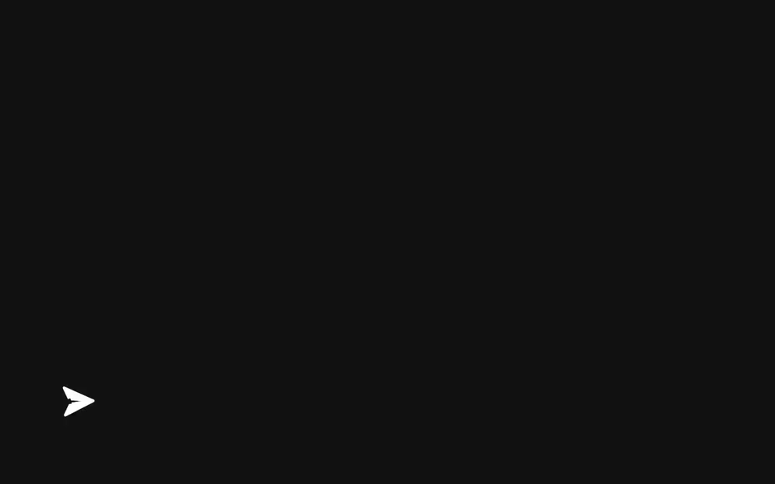
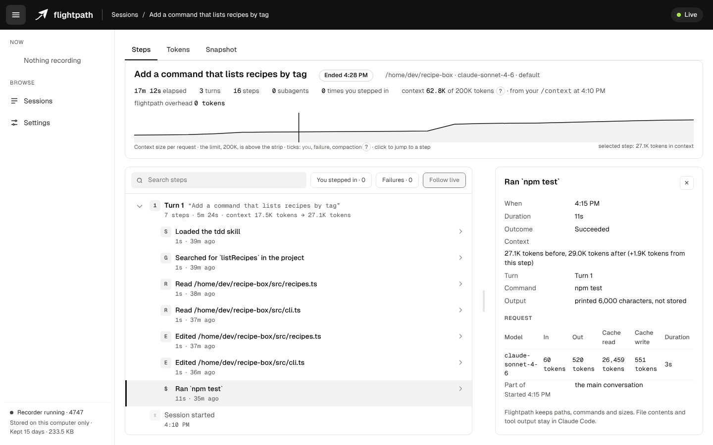
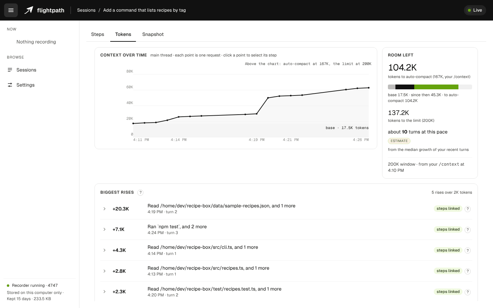
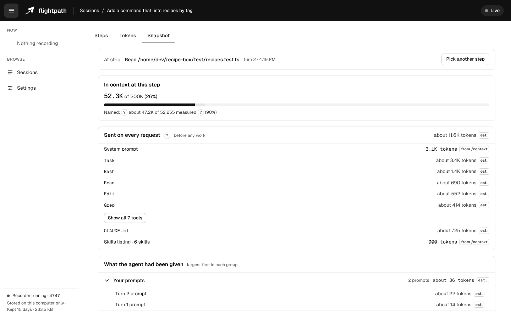

# Flightpath

**Live session insight and coaching for Claude Code.**



Flightpath runs alongside Claude Code and turns each session into a live, explorable timeline in your browser. Follow every prompt, tool call and subagent as it happens, trace each rise in context back to the step that caused it, and inspect exactly what Claude was working with at any point. A built-in coach reviews the session as it runs and points out what is worth changing, and why.

**No added token cost.** Flightpath never adds anything to Claude's context. Recording is silent, and its commands are answered on your machine without ever reaching the model. Each session shows Flightpath's own token overhead, so you can verify it yourself.

**Local only.** All data stays on your machine. Flightpath never touches your project files or changes what Claude sees.

## Install

You need **Node 24 or later** on your `PATH`. Claude Code doesn't need Node itself, so check with `node --version`. If it's missing or older, install it with [nvm](https://github.com/nvm-sh/nvm) on macOS and Linux (`nvm install 24`), [nvm-windows](https://github.com/coreybutler/nvm-windows) on Windows, or directly from [nodejs.org](https://nodejs.org). If you start Claude Code from a desktop app or an IDE, it may not see a Node installed through nvm; starting it from a terminal avoids that.

Flightpath also needs a current Claude Code. Version 1.0 is tested on Claude Code 2.1.318.

Then, in Claude Code:

```
/plugin marketplace add dk-labs-dev/flightpath
/plugin install flightpath@flightpath
```

Recording starts with your next session. Type `/flightpath:open` to see it.

Flightpath has been tested live on Windows and Linux. macOS runs the full test suite in CI.

## What Flightpath does

### Steps: a live timeline

Every turn, tool call and subagent, recorded as it happens. Select a step to see the command Claude ran, how long it took and how much it added to the context.



### Tokens: where the context goes

Context size over the session, the largest increases and the steps behind them, and the headroom left before auto-compact.



### Snapshot: what Claude is working with

The full contents of the context at any step: system prompt, tools, CLAUDE.md files and skills, each with its size. See the fixed cost of every request before any work begins.



### Coaching: suggestions as you work

Flightpath reviews the session as it runs and surfaces concrete improvements, each linked to the step that prompted it: reads of dependency folders, build output and lockfiles that a deny rule would skip, skills loaded on every request but never used, start-up files that have grown large. Each one says why it matters, links to Claude Code's documentation, and, where there's a change to make, gives you the text to copy. When a turn has a suggestion worth a look, a one-line note under Claude's reply points you to it.

## Your data stays on your machine

- Recordings live in a folder on your computer, and nothing is sent anywhere.
- Flightpath keeps file **paths**, never file contents. Tool output and Claude's replies are kept as sizes only.
- Commands Claude runs are kept in full, so you can see what ran, with known secret patterns redacted before anything is written to disk.
- Keeping your prompt text is a setting you can switch off.
- Recording Claude Code's own telemetry is off until you turn it on in settings. Turning it on adds lines to Claude Code's settings file, after making a backup of it.
- `/flightpath:forget` deletes a session, and recordings older than your retention setting are removed automatically.

Details: [privacy](docs/privacy.md).

## Commands

| Command                                  | What it does                                                  |
| ---------------------------------------- | ------------------------------------------------------------- |
| `/flightpath:open`                       | Open this session's view in your browser                      |
| `/flightpath:status`                     | Show whether this session is recording, and where the data is |
| `/flightpath:stop` · `/flightpath:start` | Pause or resume this session                                  |
| `/flightpath:off`                        | Turn recording off everywhere                                 |
| `/flightpath:forget`                     | Delete this session's recording                               |

Commands are answered on your machine and never reach the model, so they cost no tokens.

## Learn more

- [User guide](docs/guide.md): each view, the suggestions and the settings
- [Privacy](docs/privacy.md)
- [Contributing](CONTRIBUTING.md)
- [Security policy](SECURITY.md): how to report a vulnerability privately
- [Report a bug or suggest a feature](https://github.com/dk-labs-dev/flightpath/issues/new/choose)

If Flightpath helps you, a star on GitHub helps other Claude Code users find it.

## License

Apache 2.0. See [LICENSE](LICENSE) and [NOTICE](NOTICE).
